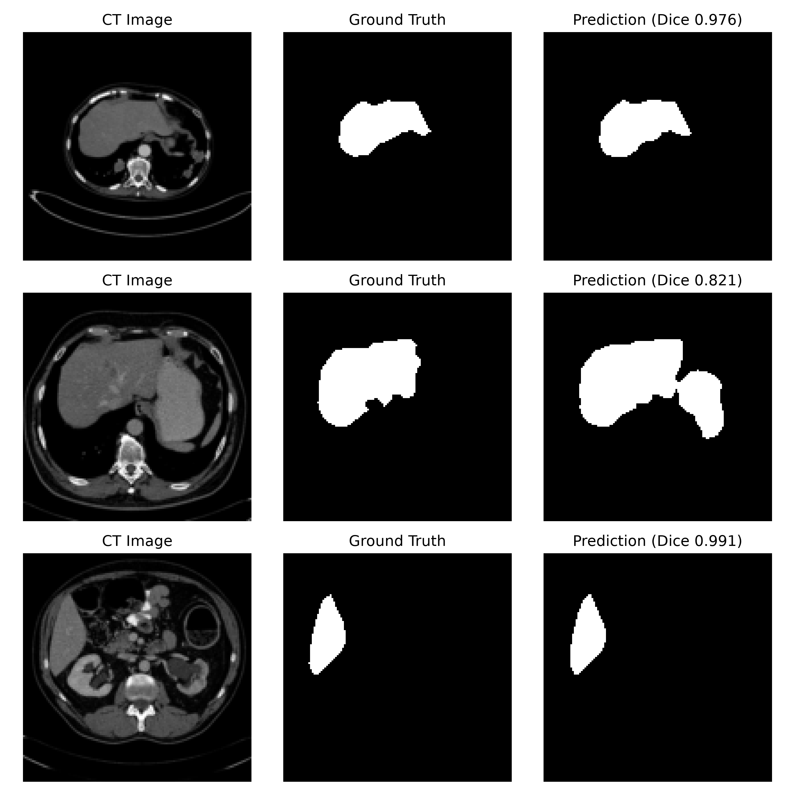
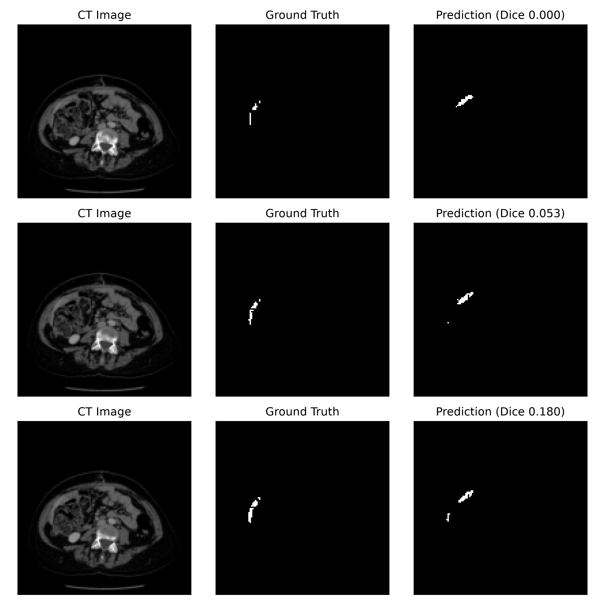
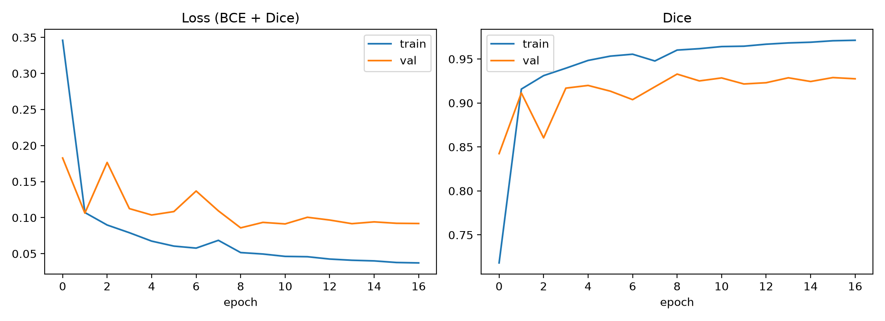

# Liver Segmentation from CT using U-Net

A 2D U-Net (TensorFlow/Keras) that segments the liver on axial abdominal CT slices, trained on the LiTS (Liver Tumor Segmentation) dataset. The whole pipeline (NIfTI to PNG conversion, patient-wise split, training and testing) is in a single script.

## Results

Evaluated on a held-out test set of **10 patients (1,566 slices)** that were never used for training or validation.

| Metric | Value (mean ± std) |
|---|---|
| Slice-level Dice | 94.48% ± 7.64 |
| Slice-level IoU | 90.26% ± 10.19 |
| Patient-level Dice | 95.64% ± 1.58 |
| Best validation Dice | 93.29% |

- *Slice-level*: metric computed on each 2D slice, then averaged.
- *Patient-level*: all test slices of one patient are pooled, Dice is computed per patient, then averaged over the 10 test patients.

Example predictions on random test slices:



Most slices are segmented almost perfectly (Dice 0.98 to 0.99). The middle row shows a typical error: a neighbouring organ on the patient's left side is partly included in the prediction (Dice 0.82).

Worst-case predictions (lowest Dice slices in the test set):



The three worst slices come from the same patient, near the lower tip of the liver, where only a thin sliver of liver is visible (Dice 0.00 to 0.18). At 128x128 these structures are only a few pixels wide and the prediction partly lands on a neighbouring structure. Very small liver cross-sections at the inferior end are the main failure mode.

Training curves:



Validation Dice plateaus around 0.93 from epoch 8 while training Dice keeps rising to about 0.97, which indicates a mild generalization gap. The validation set has only 5 patients, so its curve is noisy.

## Method

1. **Preprocessing**
   - CT intensities clipped to the HU window [-100, 400] and scaled to 0-255.
   - Liver mask = LiTS label 1 (liver) and label 2 (tumor), since tumors lie inside the liver.
   - Only slices with at least 300 liver pixels are kept.
   - Slices are saved as PNG and resized to 128x128 for training (masks resized with nearest-neighbour).
2. **Split (by patient, to avoid data leakage)**
   - 51 patients: 36 train, 5 validation, 10 test (fixed seed = 42).
3. **Model**
   - U-Net with 4 down/up-sampling levels, BatchNorm, ~1.97M parameters.
4. **Training**
   - Loss: Binary Cross-Entropy + Dice loss. Optimizer: Adam (lr = 1e-3).
   - ReduceLROnPlateau, EarlyStopping (patience 8) and best-weights checkpointing on validation Dice.
   - Trained on CPU; stopped early after 17 epochs (max 20).

## Project structure

```
.
├── liver_unet_pipeline.py        # full pipeline: convert -> split -> train -> test
├── requirements.txt
├── test_results.txt              # final test metrics
├── RESULT_random_examples.png    # example predictions
├── RESULT_worst_examples.png     # worst-case predictions
├── training_curves.png           # loss / Dice curves
└── README.md
```

Running the script creates an `outputs/` folder locally with the weights, figures and `test_results.txt`.

## Dataset

This project uses the **LiTS (Liver Tumor Segmentation) Challenge** dataset. The data is **not included** in this repository; please download it from the official source and follow its license.

Expected folder layout:

```
<DATA_DIR>/
├── volume_pt1/volume-0.nii ...
├── volume_pt2/ ...
├── ...
└── segmentations/segmentation-0.nii ...
```

## How to run

```bash
pip install -r requirements.txt
```

1. Open `liver_unet_pipeline.py` and set `DATA_DIR` in the CONFIG section to your dataset folder.
2. Run the script:
   ```bash
   python liver_unet_pipeline.py
   ```
3. Outputs are saved in `outputs/` (weights, `test_results.txt`, figures, training curves).

After the first run you can set `REBUILD_DATASET = False` to skip the PNG conversion.

## Limitations

- Only 51 volumes were used and only 10 patients are in the test set, so the numbers have some uncertainty. Results come from a single run and a single split (no cross-validation).
- The model works on 2D slices at 128x128; it has no 3D context and fine boundaries are blurred by the downsampling.
- Only slices that contain liver are used for training and testing. The model has not been evaluated on slices without liver, so false positives on such slices are not measured.
- Metrics are not directly comparable with the official LiTS challenge leaderboard (which evaluates full 3D volumes at original resolution).
- This is a research/educational project and is **not** intended for clinical use.

## Possible improvements

- Higher resolution (e.g. 256x256) and data augmentation.
- Include slices without liver and post-process predictions (largest connected component).
- Cross-validation over patients, and 2.5D or 3D U-Net variants.

## Acknowledgements

- Bilic et al., *The Liver Tumor Segmentation Benchmark (LiTS)*.
- Ronneberger et al., *U-Net: Convolutional Networks for Biomedical Image Segmentation*, 2015.

## Author

Fiza Aamir
